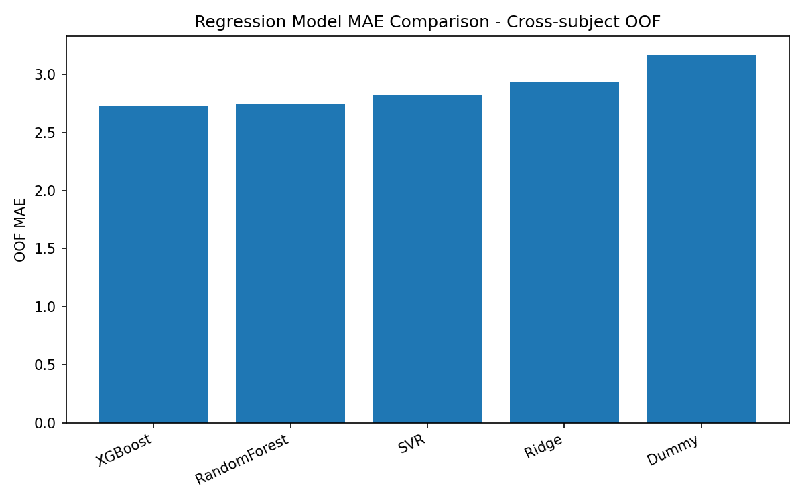

# 基于上臂 IMU 的运动疲劳评估

使用 WSD4FEDSRM 公开数据，研究上臂加速度计（ACC）和陀螺仪（Gyroscope）能否预测肩关节内旋、外旋任务中的 Borg RPE，并探索高疲劳预警。这个仓库包含从原始数据到评估结果的完整 Notebook，以及一个基于历史预测结果的 Streamlit 回放 Demo。

## 方法

- 34 名受试者，6 种运动任务。仅使用 Upper-arm ACC 和 Gyroscope；未使用磁力计、EMG 或 PPG。
- IMU 采样率 100 Hz。以 10 秒不重叠窗口切分，每个窗口与其结束时刻的 Borg RPE 对齐。
- 对六个轴及加速度、角速度各自的三轴模长，分别提取均值、标准差、最小值、最大值、极差、均方根和中位数，共 56 个时域特征。
- 排除标签缺失或传感器数据不足的窗口，得到 1310 个有效样本。
- 按受试者分组：外层 5 折评估未见受试者，内层 4 折选择超参数。回归以整体折外（OOF）MAE 为主要选择指标。
- 高疲劳分类在本项目中定义为 `RPE >= 17`，并单独分析预警阈值的漏报与误报权衡。

## 结果

| 回归模型 | OOF MAE | OOF RMSE | OOF R² |
| --- | ---: | ---: | ---: |
| XGBoost | 2.727 | 3.282 | 0.196 |
| Random Forest | 2.738 | 3.252 | 0.211 |
| Ridge | 2.929 | 3.590 | 0.038 |
| Dummy 均值基准 | 3.170 | 3.667 | -0.004 |

XGBoost 按预先设定的 MAE 主指标入选，相对 Dummy 的 MAE 下降约 14%。Random Forest 的 RMSE 和 R² 略优，两种树模型的表现接近。完整实验还包含 SVR。分类模型的最佳 OOF ROC-AUC 为 0.646，预警阈值降低后召回率提高，同时误报显著增加。



## 运行

建议使用 Python 3.11 或 3.12。从仓库根目录安装依赖：

```bash
python -m pip install -r requirements.txt
```

从[原始数据记录](https://zenodo.org/records/8415066)获取 `WSD4FEDSRM.zip`，放在**仓库的上一级目录**，保持压缩包名不变。然后从仓库根目录启动 Jupyter，依次运行 [完整复现 Notebook](notebooks/07_full_resume_final_reproduction.ipynb)：

```bash
jupyter lab
```

Notebook 会在需要时解压数据，生成特征表、外层 OOF 预测、模型指标及 Demo 回放数据。完整的嵌套交叉验证包含多次参数搜索，运行时间取决于硬件。

仓库已包含一份历史 OOF 回放数据，因此无需重新训练也可查看 Demo：

```bash
streamlit run streamlit_app.py
```

Demo 按受试者、任务和时间窗口展示真实与预测 RPE、高疲劳概率和预警状态。它使用离线数据的 OOF 预测进行历史回放，不连接实时传感器，也不提供医疗判断。

## 仓库内容

- `notebooks/07_full_resume_final_reproduction.ipynb`：从原始压缩包到结果和 Demo 的自包含流程。
- `streamlit_app.py`：历史结果回放界面。
- `data_processed/demo_predictions_final.csv`：用于回放的派生结果；不含原始传感器流。
- `results/resume_final/`：主要汇总指标与回归图。完整逐窗口结果可由 Notebook 重新生成。

## 数据来源与局限

数据来源：[A dataset for fatigue estimation during shoulder internal and external rotation movements using wearables](https://doi.org/10.1038/s41597-024-03254-8)，原始数据由作者发布于 [Zenodo](https://zenodo.org/records/8415066)，按其 CC BY 4.0 条款使用。原始数据没有复制进本仓库；回放 CSV 是基于该数据集生成的派生结果。

当前仅有 34 名受试者，RPE 是主观评分，特征只来自一个佩戴位置的简单时域统计量。结果反映跨受试者实验性能，不代表已经完成实时部署。
